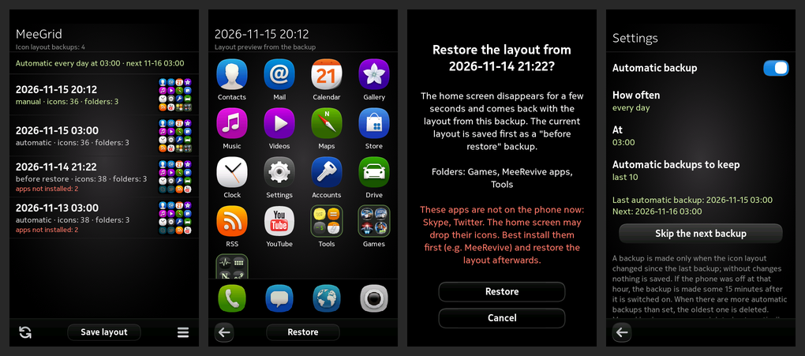

# MeeGrid for Nokia N9

Backup and restore of the home screen icon layout for the Nokia N9 (MeeGo Harmattan PR1.3):
icon positions, folders and the quick launch bar. Useful before and after reflashing, or when the
layout gets scrambled (icons moved into folders, duplicated shortcuts).



- **Save layout** writes a backup to `MyDocs/MeeGrid/meegrid-DATE-TIME-manual.tar.gz`.
- **Backup list** with a small picture of each layout, number of icons and folders, and how many
  apps from that backup are not installed on the phone now.
- **Preview**: tap a backup to see the home screen drawn from its data, with the real app icons,
  folders (and what is inside them) and the quick launch bar. Apps that are not installed are dimmed.
- **Restore** from the preview. The current layout is saved first as a "before restore" backup,
  so a restore can always be undone. The home screen disappears for a few seconds and comes back
  with the restored layout. Missing apps are listed before you confirm.
- **Automatic backup** (Settings): on/off, every day or once a week, at a chosen hour, how many to
  keep (the oldest automatic one is deleted). A backup is made only when the layout has changed.
  The next planned backup can be skipped. Manual backups are never deleted automatically.
- Languages: English, Polish.

## After a reflash

1. Before flashing, copy `MyDocs/MeeGrid` to a computer (a full flash with the eMMC image erases MyDocs).
2. After flashing, install your apps first, then MeeGrid, and put the `MeeGrid` folder back into MyDocs.
3. Open MeeGrid, tap the backup, check the preview and tap Restore.

## How it works

The launcher (meegotouchhome) keeps the layout in `~/.config/meegotouchhome-nokia/launcherbuttons.data`
plus `folderN.directory` and `quicklaunchbarN.desktop` files in `~/.local/share/applications`.
A backup is a tar.gz of these files with `meegrid.json` (positions, app names and icons, installed packages).

The launcher has to be stopped while its files are replaced, otherwise it writes the old layout back.
Killing it is not safe: its upstart job (`xsession/mthome`) reboots the phone after a few restarts.
So the package includes a small root service (`/etc/init/apps/meegrid-n9.conf`, `meegridd.py`) that,
on request from the app, runs `initctl stop xsession/mthome`, copies the files as user `user` and
starts the launcher again. It also runs the automatic backup check every 15 minutes.

## Install

Copy `dist/meegrid-n9_0.1.2_all.deb` to the phone and, as root:

```
aegis-dpkg -i meegrid-n9_0.1.2_all.deb
```

Needs Python 2.6, PySide and Qt Components (all on a stock PR1.3). The service starts right after
installation; after a reboot it starts a few minutes after the phone is up. MeeGrid is also part of
[MeeRevive](https://github.com/smyhu/meerevive-n9).

Build the package: `sh packaging/build-deb.sh` (needs ar, tar, python3 with Pillow).

Designed and written by Claude (Anthropic) together with smyhu for the Nokia N9.
MIT License, Copyright (c) 2026 smyhu.
